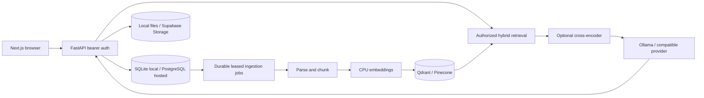
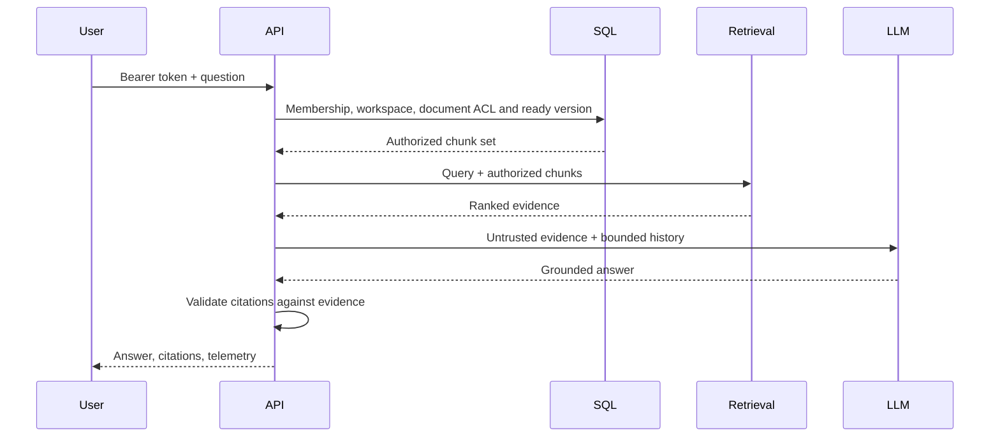

# Architecture

SQL metadata is the authority for ownership, document status and versions. Vector storage accelerates similarity search; it never grants permission. The backend selects authorized current chunks before retrieval or model inference. BM25 operates on that same authorized set.

Keep one API process for local embedded Qdrant. SQL jobs survive API restarts; the bounded worker can be invoked again after its lease expires. Free hosting has no persistent worker guarantee. See INGESTION_PIPELINE.md.
