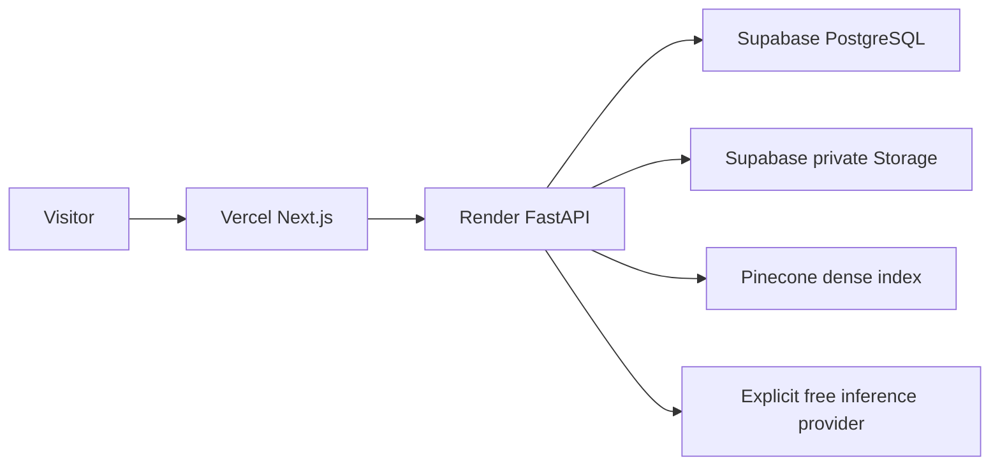

# Deployment runbook

Deployment templates are prepared, but no account provisioning or public deployment is claimed. Required external inputs are a repository remote, Render/Vercel access, Supabase project credentials, Pinecone index/API key and an available free inference model. Keep secrets in provider settings.

1. Run all checks in TESTING.md. Push the tested source and lockfiles to your repository.
2. Create a Supabase project within free limits. Create a **private** `documents` bucket. Use the backend service credential only on the API host. Set a PostgreSQL SQLAlchemy URL with `postgresql+psycopg://` and the provider's required TLS/pooler settings.
3. Create a Pinecone dense cosine index matching `EMBEDDING_DIMENSION` (384 for the default BGE-small model). Use the currently eligible Starter region; verify limits in the console. Do not mix models in one index.
4. Import `infra/deployment/render.yaml` as a Render Blueprint. It creates two services from one image: `aster-rag-api` (web, free plan) and `aster-rag-worker` (background worker, paid plan because Render's free tier has no background workers). Supply each `sync: false` secret on both services. Set `ENVIRONMENT=hosted`, `STORAGE_BACKEND=supabase`, `VECTOR_BACKEND=pinecone`, an explicit `LLM_MODEL`, `GROQ_API_KEY`, and the final allowed frontend `CORS_ORIGINS`. Backend startup rejects ephemeral hosted persistence configurations.

   Environment variables configured by the blueprint:

   | Variable | Purpose |
   |---|---|
   | `ENVIRONMENT` | `hosted` enables the persistence checks. |
   | `STORAGE_BACKEND` | `supabase` stores uploads in private Supabase Storage. |
   | `VECTOR_BACKEND` | `pinecone` for hosted vectors. |
   | `JWT_SECRET` | Generated per service; the worker never issues tokens. |
   | `DATABASE_URL`, `SUPABASE_URL`, `SUPABASE_SERVICE_KEY`, `PINECONE_API_KEY`, `PINECONE_INDEX` | Backend credentials supplied in the Render dashboard. |
   | `CORS_ORIGINS` | Exact frontend origin(s); `*` is rejected because sessions use credentialed cookies. |
   | `WEB_URL` | Public frontend URL used in verification links (`{WEB_URL}/?verify=<token>`). Required when hosted. |
   | `SMTP_HOST`, `SMTP_PORT`, `SMTP_USER`, `SMTP_PASSWORD`, `SMTP_FROM`, `SMTP_STARTTLS` | Outgoing mail for email verification. Hosted mode defaults `REQUIRE_EMAIL_VERIFICATION=true` and refuses to start without `SMTP_HOST`. |
   | `LLM_PROVIDER`, `LLM_MODEL`, `GROQ_API_KEY` | Inference provider, explicit model and key. |
   | `REGISTRATION_ENABLED`, `DEMO_ENABLED` | Keep `false` unless deliberately enabled. |
   | `FORWARDED_ALLOW_IPS` | Proxy addresses whose `X-Forwarded-For` is trusted (default `127.0.0.1`). Behind Render's proxy the client IP is only visible when this matches the proxy's address; set it deliberately, and never to `*` on a service reachable without the platform proxy. |

   The web start command runs `alembic -c apps/api/alembic.ini upgrade head` before uvicorn, because `preDeployCommand` is not available on the free plan. Deploy the web service first on a new database so the worker does not start against an unmigrated schema; if it does, it restarts until the tables exist.
5. Migrations run automatically on web start (see step 4). To migrate manually instead, run `uv run alembic -c apps/api/alembic.ini upgrade head` from a trusted local terminal with the hosted environment. Never expose SQL credentials in shell history or screenshots.
6. Seed safe content using `uv run python -m rag_api.cli seed-demo --process`. Configure `DEMO_WORKSPACE_ID=fictional-demo-workspace`, then enable `DEMO_ENABLED=true`. The seed owner has no login password; create a separate administrator through a temporarily restricted registration endpoint if required. Keep public registration disabled for the demo.
7. Import the frontend into Vercel with Root Directory `apps/web`. The example `infra/deployment/vercel.json` contains equivalent framework/build settings; copy it to that project root if a config file is desired. Set `NEXT_PUBLIC_API_URL` to the API base specified in `.env.example`. Build again after changing public environment variables.
8. The `aster-rag-worker` service polls the job queue continuously. For a bounded run, invoke `uv run python -m rag_api.worker --once` or the authenticated bounded job endpoint until safe demo documents are ready. Jobs whose lease expires 5 times (`MAX_JOB_ATTEMPTS` in `apps/api/rag_api/jobs.py`) are marked `failed` with a `LeaseExpired` error and are not retried.
9. Import an actual report with `uv run python -m rag_api.cli import-evaluation --workspace fictional-demo-workspace --report datasets/results/local-onnx.json`. Only use the report for the bundled fictional corpus; it does not measure a user's uploaded documents.
10. Verify from a separate browser: login/demo, question with citations, source access, search inspector, failed-provider display, unauthorized source denial, and persistence after API restart. Record URLs and measured cold-start behavior only after they work.

Render can gate auto-deploys on checks; configure GitHub branch protection to require all backend/frontend/RAG checks. Vercel Git integration needs corresponding deployment controls; a template alone does not enforce organization policy. Roll back to a known-tested commit if checks or smoke tests fail.

Cloud deployment remains incomplete until credentials/resources are supplied and the end-to-end checks pass. Free-tier CPU memory and cold-start viability are unresolved until measured on the actual instance.

## Cookie sessions across domains

Browser sessions use an HttpOnly `atlas_session` cookie. When hosted the cookie is `SameSite=None; Secure`, which is what a frontend and API on different registrable domains (for example `*.vercel.app` and `*.onrender.com`) require. Safari/Firefox ITP and third-party-cookie blocking may drop such cookies, so sign-in can silently fail there. Serve both under one parent domain (for example `app.example.com` and `api.example.com`); bearer-token API clients are unaffected.
