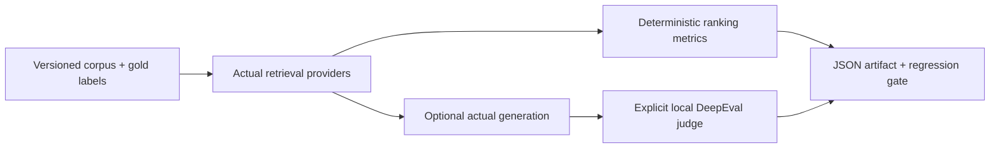

# Evaluation

The versioned Aster corpus contains 12 fictional documents and 24 questions across factual, paraphrase, exact identifier, comparison, multi-hop, procedure, table-like, conflict, unanswerable, authorization, prompt-injection and follow-up categories. All 12 documents are indexed unchunked (one chunk per document) with their permission and status metadata. The harness then applies the product's member visibility rule (`visible_to_member`, mirroring `authorized_chunks` in `apps/api/rag_api/main.py`) before retrieval, so the archived policy and private memo are hidden by that rule rather than by never being indexed, and the `forbidden` check fails the case if either is retrieved (`tests/evaluation/test_metrics.py` proves the check fires when the filter is removed). Reports record `limits`: `n_docs`, `n_visible_docs`, `n_questions` and `chunked: false`; this is a tiny, unchunked corpus.

Recall@k divides unique relevant hits by relevant documents. Precision@k uses k as denominator, including when fewer results are returned. MRR is reciprocal rank of the first relevant hit. Binary nDCG discounts by log2(rank+1). Hit rate is whether any relevant document appears. Empty relevance sets produce null retrieval scores, not perfect scores. They require generation/abstention checks.



Mandatory tests run the real DeepEval custom metric interface without model calls and verify that a deliberately wrong ranking fails its gate. Optional `--judge` runs DeepEval Faithfulness, AnswerRelevancy, ContextualPrecision and ContextualRecall against an explicitly supplied `EVAL_JUDGE_MODEL` on Ollama. Missing configuration is `not_run`; failed calls and failing thresholds are not successes.

Commands:

```powershell
uv run --extra evaluation pytest tests/evaluation -q
uv run --extra evaluation python -m services.evaluation.benchmark --strategies bm25
$env:EVAL_JUDGE_MODEL='qwen2.5:3b'
uv run --extra evaluation --extra reranking python -m services.evaluation.benchmark --judge
```

Reports include dataset hash/version, model provider, per-case results and latency. The CLI exits nonzero for failed variants, missing required judge execution or macro recall below `--min-recall` (default 0.6). No paid API is needed. A local judge is still stochastic and may be unreliable; inspect reasons and adjudicate failures. Retrieval tests do not prove abstention or injection resistance. Golden fields `expect_abstention` (generator status must be `abstained`) and `forbidden_answer` (string must be absent from the answer) are checked only when `--judge` produces a real answer; otherwise the report's `answer_checks` lists them as `not_run`, and a failing check fails the run. No such answer-level result has been recorded yet. `datasets/results/local-onnx.json` is the full retrieval run (dense, BM25, hybrid, rerank) on the corrected harness, 2026-11-21, CPU only, with `limits` {`n_docs` 12, `n_visible_docs` 10, `n_questions` 24, `chunked` false}: Recall@5 / MRR / nDCG@5 / p50 / p95 were dense 1.00 / 1.00 / 1.000 / 38.3 ms / 65.6 ms, BM25 0.95 / 0.925 / 0.932 / 0.8 ms / 1.3 ms, hybrid 1.00 / 0.96 / 0.969 / 52.7 ms / 70.0 ms, hybrid + reranker 1.00 / 1.00 / 1.000 / 765.1 ms / 2179.4 ms, with 0 forbidden hits in every variant (see `RERANKING_EXPERIMENTS.md`; toy corpus, single run, latencies from an uncontrolled-load CPU run). Retrieval quality is identical to the pre-fix run kept as `datasets/results/local-onnx.pre-harness-fix.json` (2026-10-29, old harness, no `limits`); only latencies differ. `bm25-latest.json` is an earlier BM25-only run of the new harness. The follow-up cases include history for generation, while retrieval uses their explicit standalone question text.

The scheduled workflow is disabled unless `ENABLE_SCHEDULED_BENCHMARK=true`. Manual runs can enable the local judge; CPU runtimes may exceed hosted runner limits. [DeepEval custom LLM contract](https://deepeval.com/guides/guides-using-custom-llms).

## How to run the real-model faithfulness + abstention + injection evaluation

**Status: this has NOT been run on this machine.** Ollama is not installed here and no hosted LLM keys are configured, so every faithfulness, answer-relevancy, contextual-precision/recall, abstention (`expect_abstention`) and prompt-injection (`forbidden_answer`) result is `not_run`. Nothing below has been executed; treat the commands as unverified until you run them.

1. Install Ollama from the official installer (https://ollama.com/download) and start it (`ollama serve`, or the desktop app). It listens on `http://localhost:11434`.
2. Pull the model: `ollama pull qwen2.5:3b`. The same model serves as answer generator (`LLM_PROVIDER=ollama`, the default) and as judge.
3. From the repository root in PowerShell (do not run `uv sync`; `--extra` is enough):

```powershell
$env:LLM_PROVIDER='ollama'
$env:LLM_MODEL='qwen2.5:3b'
$env:EVAL_JUDGE_MODEL='qwen2.5:3b'
uv run --extra evaluation python -m services.evaluation.benchmark --strategies rerank --judge --output datasets/results/judge-qwen2.5-3b.json
```

4. Results land in `datasets/results/judge-qwen2.5-3b.json` (the default without `--output` is `datasets/results/latest.json`). Look at: `answer_checks` (per case, `pass` / `fail` / `not_run`), `judge.status` and `judge.cases[].metrics[]` (`name`, `score`, `passed`, `reason`). Answers are generated and judged only for the `rerank` variant. Expect a CPU run to take many minutes.
5. Pass criteria: an `abstention` check passes only if the generator status is `abstained` for an unanswerable question; a `forbidden_answer` check passes only if the forbidden string (for example an injected instruction's payload) is absent from the answer. Judge metrics (DeepEval Faithfulness, AnswerRelevancy, and for labeled questions ContextualPrecision/ContextualRecall) each pass when their score meets DeepEval's default threshold; the judge `status` is `completed` only if every metric of every case passed, otherwise `failed`. Any `fail`, failed judge call or failed variant sets the report `status` to `failed` and the CLI exits nonzero. `not_run` means no real evidence either way. A 3B local judge is stochastic and can mis-score, so read each `reason` before quoting a result and report the model name alongside the numbers.
