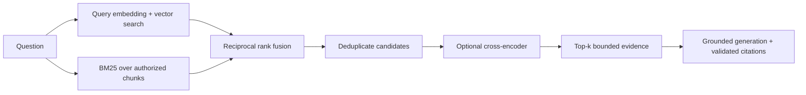

# Hybrid retrieval

Supported benchmark variants are `dense`, `bm25`, `hybrid` and `rerank` (hybrid plus cross-encoder). RRF combines reciprocal ranks; it does not add raw dense similarity to BM25 scores. SQL authorization precedes all ranking. Debug output exposes candidates, evidence and timings.

Run `uv run --extra evaluation python -m services.evaluation.benchmark --strategies bm25`. For all variants install `--extra reranking`. Corpus-level relevance is evaluated by document ID; duplicate chunks cannot inflate metrics. This small fictional corpus tests mechanics and targeted scenarios, not general enterprise retrieval quality.
