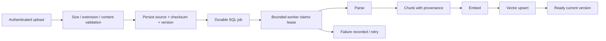

# Ingestion

Initial parsing supports PDF, DOCX, text, Markdown, HTML and CSV. Scanned PDFs require OCR; the application must report insufficient extracted text rather than fabricate extracted content. OCR, malware scanning and office sandboxing are deployment hardening work, not implied certifications.

Document IDs and versions connect source storage, chunks and vector records. Only ready current-version chunks enter retrieval. Jobs use persisted state and leases instead of transient FastAPI background tasks. An administrator invokes a bounded batch; failed jobs remain inspectable and reindexing can queue another attempt.

Reindex after changing embedding models, dimensions or chunking. Do not mix embeddings in an existing index. Deletion must remove the source and vector records as well as hiding the SQL document; inspect failed deletion jobs before treating removal as complete.
