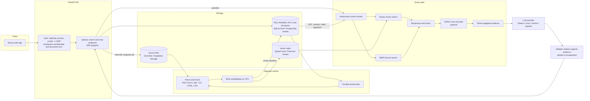

# Aster • Enterprise knowledge assistant

A fictional enterprise corpus, permission-aware retrieval, BM25 + dense reciprocal-rank fusion, optional cross-encoder reranking, and cited answers through an OpenAI-compatible provider. FastAPI serves a Next.js interface. The default development path uses CPU embeddings, local storage and Ollama without paid APIs.

## Architecture

SQL is the authority for permissions. The API selects the chunks the caller may read (workspace, document ACL, ready and current version) **before** any ranking or model call. The vector index only speeds up similarity search and never grants access.

More detail: [architecture docs](docs/architecture/ARCHITECTURE.md), [hybrid retrieval](docs/architecture/HYBRID_RETRIEVAL.md) and [ingestion pipeline](docs/architecture/INGESTION_PIPELINE.md).

## Start on Windows

Install Python 3.12, uv, Node.js 22 LTS and Ollama. Run `./scripts/check-environment.ps1`, then `./scripts/setup.ps1`. Copy `.env.example` to `.env` if not already created. Run `ollama pull qwen2.5:3b`.

In one terminal run `./scripts/start-api.ps1`. In another run `cd apps/web; npm run dev`. Open [localhost:3000](http://localhost:3000); API schema is [localhost:8000/docs](http://localhost:8000/docs).

Register a workspace, upload a Markdown or text document, and run the bounded ingestion worker as an administrator before asking questions. Models download on first use. See [LOCAL_SETUP.md](docs/getting-started/LOCAL_SETUP.md) for limitations and Docker setup.

## Verification and evidence

`./scripts/verify.ps1` runs the Python and frontend checks. `uv run --extra evaluation python -m services.evaluation.benchmark --strategies bm25` records measured lexical retrieval results. Full semantic and ONNX reranking evaluation: `uv run --extra evaluation python -m services.evaluation.benchmark`.

Reports live in `datasets/results`. Missing models or judges are failures or `not_run`, never successful fabricated results. Deterministic test embeddings are not semantic benchmarks. See [EVALUATION.md](docs/quality/EVALUATION.md).

See [verification evidence](docs/quality/VERIFICATION.md) and [delivery status and limitations](docs/quality/DELIVERY_STATUS.md) for the exact implemented scope. To enable the bundled demo locally, follow the seed/import commands in [LOCAL_SETUP.md](docs/getting-started/LOCAL_SETUP.md).

Deployment templates are provided; **no public deployment is claimed**. Account credentials, resource provisioning and live verification remain required. See [DEPLOYMENT.md](docs/operations/DEPLOYMENT.md), [COST_AND_LIMITS.md](docs/operations/COST_AND_LIMITS.md), and [SECURITY.md](SECURITY.md). This is a portfolio implementation, not a certified compliance product.

## Repository

| Path | Responsibility |
|---|---|
| `apps/api/rag_api` | Auth, SQL metadata, source storage, durable jobs, API |
| `apps/web` | Chat, library, inspector, evaluation and admin interface |
| `services/rag` | Parsing, chunking, embedding, retrieval, generation |
| `services/evaluation` | Retrieval metrics and local DeepEval adapter |
| `datasets` | Fictional corpus, golden cases, actual result artifacts |
| `infra`, `.github`, `scripts` | Deployment, checks and Windows tooling |
| `docs` | Setup, architecture, operations, quality evidence and design ([index](docs/README.md)) |
