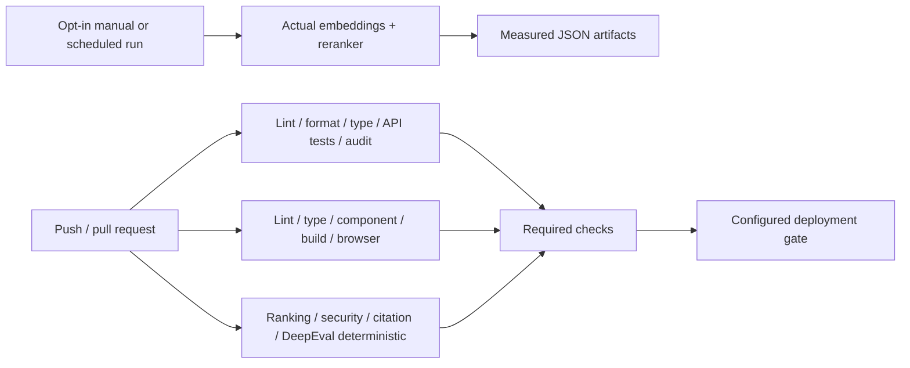

# Verification

Run from repository root with installed dependencies:

```powershell
uv sync --frozen --extra evaluation
uv run ruff check apps/api services tests
uv run ruff format --check apps/api services tests
uv run mypy apps/api/rag_api --ignore-missing-imports --follow-imports=silent
uv run pytest tests -q
uv run python -m services.evaluation.benchmark --strategies bm25
cd apps/web
npm ci
npm run lint
npm run typecheck
npm test
npm run build
npx playwright install chromium
npm run test:e2e
```

Provider doubles are explicitly injected only in deterministic tests. A passing unit suite does not prove real model quality, cloud quota availability or deployment correctness. Run the semantic benchmark and optional local judge separately. Inspect the generated JSON, not just process exit status.



The GitHub workflows define required checks but branch protection must be configured in the repository. Scheduled benchmarks are opt-in through `ENABLE_SCHEDULED_BENCHMARK=true`. Judge execution is explicitly selected on manual dispatch. Artifacts are uploaded even when the benchmark fails.

After deployment, test a real upload through parsing/indexing, current-version reindex, deletion, conversation follow-up, provider failure, cross-tenant source denial, rate limiting, and persistence after restart. Record actual timings. Production load testing and compliance certification are outside the passing local test claim.
